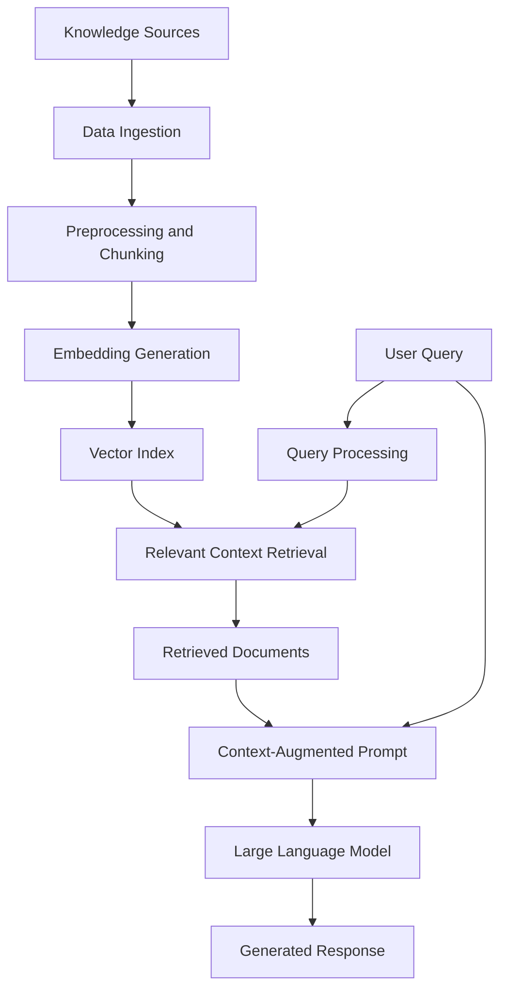

# RAG_App — Retrieval-Augmented Generation

[](https://www.python.org/)
[](https://en.wikipedia.org/wiki/Retrieval-augmented_generation)
[](LICENSE)


[](https://colab.research.google.com/github/m-ymn/RAG_App/blob/main/rag_app.ipynb)

A Python-based project exploring **Retrieval-Augmented Generation (RAG)**, a technique that combines information retrieval with Large Language Models (LLMs) to generate context-aware responses grounded in external knowledge.

## Overview

Large Language Models can generate natural-language responses but may lack access to specific documents, private knowledge bases, or information outside their training data.

Retrieval-Augmented Generation addresses this limitation by retrieving relevant information from an external knowledge source and providing it to the LLM as contextual input before response generation.

This project contains a RAG implementation organized around a standalone application, supporting data resources, and a Jupyter notebook for experimentation.

## Architecture

A typical RAG pipeline consists of the following stages:

1. **Data ingestion:** Load documents or other knowledge sources.
2. **Preprocessing and chunking:** Prepare the content and divide it into manageable text segments.
3. **Embedding generation:** Convert text into vector representations.
4. **Indexing:** Store embeddings in a searchable index.
5. **Retrieval:** Identify relevant document segments for a user query.
6. **Context augmentation:** Combine the retrieved content with the user's question.
7. **Response generation:** Provide the augmented prompt to an LLM to generate a response.

### RAG Pipeline Diagram



*Note: This diagram illustrates the general RAG workflow. The actual components and sequence depend on the implementation.*

## Repository Structure

```text
RAG_App/
├── Data/              # Data resources
├── Standalone_app/    # Standalone application
├── rag_app.ipynb      # Jupyter notebook
├── LICENSE            # MIT License
└── README.md          # Project documentation
```

## Getting Started

### Prerequisites

- Python 3.x
- Git
- Jupyter Notebook or JupyterLab (for notebook-based experimentation)
- Additional packages and credentials required by the implementation

### 1. Clone the Repository

```bash
git clone https://github.com/m-ymn/RAG_App.git
cd RAG_App
```

### 2. Create a Virtual Environment

**Windows**

```bash
python -m venv .venv
.venv\Scripts\activate
```

**Linux / macOS**

```bash
python3 -m venv .venv
source .venv/bin/activate
```

### 3. Install Dependencies

Install the dependencies specified by the project. If a `requirements.txt` file exists in the relevant directory, run:

```bash
pip install -r requirements.txt
```

If dependencies are managed through another configuration file, use the corresponding installation instructions.

### 4. Explore the Jupyter Notebook

Install and launch Jupyter if it is not already installed:

```bash
pip install jupyter
jupyter notebook
```

Open `rag_app.ipynb` and execute the cells in order. Configure the required data paths, model settings, and credentials as appropriate.

### 5. Run the Standalone Application

Navigate to the application directory:

```bash
cd Standalone_app
```

Follow the instructions for the application's entry point and dependency configuration. The precise launch command depends on the files provided in that directory.

## Key Concepts

| Component | Description |
|---|---|
| Data ingestion | Loads the source knowledge |
| Text chunking | Divides documents into smaller segments |
| Embeddings | Represent text as numerical vectors |
| Indexing | Makes document representations searchable |
| Retrieval | Finds context relevant to a query |
| Prompt augmentation | Supplies retrieved context to the LLM |
| Generation | Produces a context-aware response |

These are standard RAG concepts rather than a verified inventory of the specific libraries used in this repository.

## Potential Applications

RAG can be applied to:

- Question answering over custom documents
- Knowledge-base assistants
- Semantic search systems
- Context-aware conversational applications
- Domain-specific information retrieval

## Limitations

- Retrieval quality depends on the source data and indexing strategy.
- Poorly chosen document chunks can reduce contextual relevance.
- Generated responses may still contain inaccurate information.
- Latency and operating costs depend on the retrieval infrastructure and selected models.

## Future Improvements

Potential enhancements include:

- Comparing embedding models and retrieval strategies
- Experimenting with chunk sizes and overlap
- Adding document reranking and query transformation
- Providing source references for generated answers
- Evaluating retrieval precision and answer quality
- Measuring end-to-end latency and resource usage

## License

This project is licensed under the **MIT License**.

You are free to use, modify, distribute, and incorporate the software into other projects, subject to the license terms and preservation of the required copyright and permission notices.

See the [LICENSE](LICENSE) file for the full license text.

## Author

**m-ymn**

- GitHub: [@m-ymn](https://github.com/m-ymn)
- Repository: [RAG_App](https://github.com/m-ymn/RAG_App)
